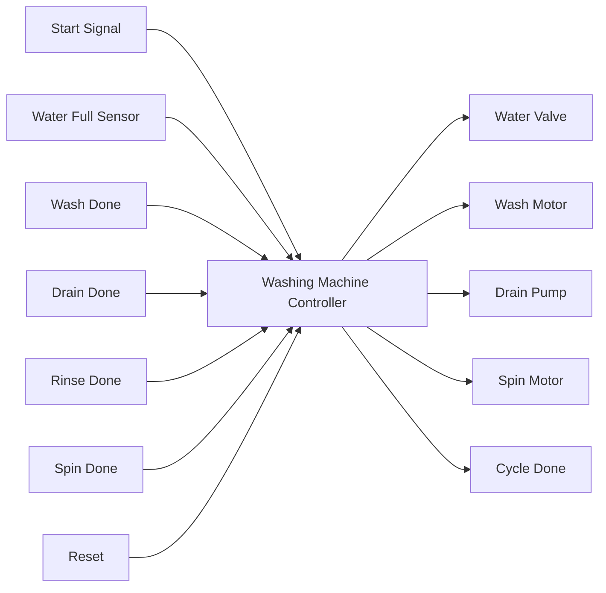
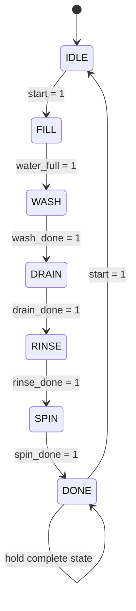

# Washing Machine Control System

<p align="center">
  
  
  
</p>

A compact RTL-based washing machine controller implemented in Verilog. The design models the operational lifecycle of a washing machine using a finite state machine (FSM), coordinating water filling, washing, draining, rinsing, spinning, and completion signaling.

## Overview

This project demonstrates how a real-world appliance control sequence can be modeled using digital hardware design principles. The controller accepts a set of status signals from the machine environment and transitions through a predefined sequence of states to perform a complete washing cycle.

The design is suitable for:
- Digital design coursework and lab projects
- FSM-based hardware modeling
- RTL simulation and verification practice
- Embedded appliance control logic prototyping

## Features

- Finite state machine based controller
- Safe sequential operation from idle to cycle completion
- Dedicated states for:
  - filling water
  - washing
  - draining
  - rinsing
  - spinning
  - done
- Moore-style output logic for clean state-driven control signals
- Testbench included for simulation and verification

## Block Diagram



## System Architecture

The design consists of a single top-level module named `washing_machine` and a testbench `washing_machine_tb.v` that drives it under simulation.

### Top-Level Module

`washing_machine` is responsible for:
- tracking the current machine state
- determining next-state transitions
- generating actuator control outputs
- asserting completion when the cycle ends

## State Machine



## Signal Description

| Signal | Direction | Description |
|--------|-----------|-------------|
| `clk` | input | System clock |
| `reset` | input | Resets the FSM to IDLE state |
| `start` | input | Starts a new washing cycle |
| `water_full` | input | Indicates the water tank is filled |
| `wash_done` | input | Indicates washing phase is complete |
| `drain_done` | input | Indicates draining phase is complete |
| `rinse_done` | input | Indicates rinsing phase is complete |
| `spin_done` | input | Indicates spinning phase is complete |
| `water_valve` | output | Controls water inlet valve |
| `wash_motor` | output | Activates the washing motor |
| `drain_pump` | output | Activates the drain pump |
| `spin_motor` | output | Activates the spin motor |
| `cycle_done` | output | Indicates the full washing process is complete |

## FSM States

| State | Function |
|-------|----------|
| `IDLE` | Waits for the user to start the cycle |
| `FILL` | Opens the water valve until the tank is full |
| `WASH` | Runs the washing motor |
| `DRAIN` | Removes water via the drain pump |
| `RINSE` | Performs the rinse stage |
| `SPIN` | Runs the spin motor to remove excess water |
| `DONE` | Signals cycle completion |

## Operation Sequence

1. The machine remains in `IDLE` until `start` is asserted.
2. It transitions to `FILL` and turns on the water valve.
3. Once `water_full` is detected, it moves to `WASH`.
4. After `wash_done`, it goes to `DRAIN`.
5. After `drain_done`, it enters `RINSE`.
6. After `rinse_done`, it moves to `SPIN`.
7. When `spin_done` is asserted, the FSM reaches `DONE` and sets `cycle_done` high.
8. A new cycle can begin again when `start` is triggered.

## File Structure

```text
Washing_Machine/
├── README.md
├── washing_machine.v
└── washing_machine_tb.v
```

## Simulation

To compile and run the design using Icarus Verilog:

```bash
iverilog -g2012 washing_machine.v washing_machine_tb.v -o washing_machine_tb
vvp washing_machine_tb
```

This simulation will exercise the FSM and print the state and output transitions in the terminal.

## Example Output

```text
Time=... | State=... | Valve=... | Wash=... | Drain=... | Spin=... | Done=...
TEST PASSED: Washing cycle completed!
```

## Applications

This controller can be adapted for:
- home appliance control logic
- industrial washing systems
- educational digital design experiments
- FSM verification projects

## Conclusion

This project provides a clear and efficient example of finite state machine design in hardware description language. It represents a realistic case of appliance behavior and demonstrates how sequential logic can be modeled and verified using Verilog.

## Author

Designed as a digital electronics / embedded systems learning project focused on RTL modeling and FSM-based control.
